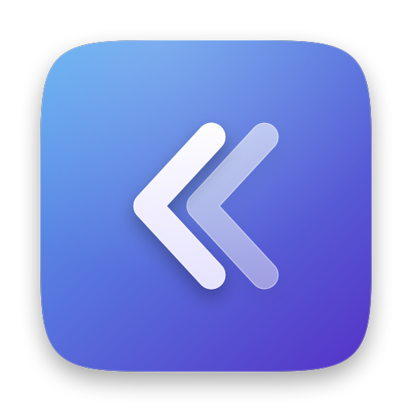

<p align="center">
  <picture>
    <source media="(prefers-color-scheme: dark)" srcset="Icon/previews/glass-dark.png">
    
  </picture>
</p>

# Tacet

*Tacet*: the musical term for a part that stays silent until its turn.
Formerly called MenuShelf (the notes keep that name as history).

A minimal menu bar manager (in the spirit of Hidden Bar, Bartender and Ice) for
**macOS 27 only**. Swift + AppKit, SwiftUI for the windows. Agent app
(`LSUIElement`), not sandboxed.

See [NOTES-macos27.md](NOTES-macos27.md) for how the macOS 27 menu bar works and
why hiding is done the way it is.

## Requirements

- macOS 27 (tested on 27.0.1, build 26A434).
- Swift 6 toolchain. The Command Line Tools are enough; Xcode is not needed.

## Build and run

```bash
./scripts/build-app.sh
```

```bash
open /Applications/Tacet.app
```

The script:
- runs `swift build -c release`;
- assembles `build/Tacet.app` with `Support/Info.plist`;
- signs it (see Permissions);
- quits a running Tacet and installs the app to `/Applications`.

Running from `/Applications` is no longer required (it was for the old
restriction), but it is where the app lives. Use
`CONFIG=debug ./scripts/build-app.sh` for a debug build, and `INSTALL=0` to
skip installing.

To see the debug output live, run the binary from a terminal instead of `open`:

```bash
/Applications/Tacet.app/Contents/MacOS/Tacet
```

Output also goes to `~/Library/Logs/Tacet.log` and the unified log
(subsystem `app.gettacet.Tacet`).

## How it works

Tacet hides apps with the **"Allow in the Menu Bar" switches** of System
Settings › Menu Bar. macOS does the hiding and the animation, so Notification
Center, Focus, the camera/mic indicator and Now Playing keep working. Details
and measurements: [NOTES-macos27.md](NOTES-macos27.md) §12–13.

- **Choose apps:** right-click the arrow › **Settings…**. Under **Hide in
  Tacet**, every app macOS lists under "Allow in the Menu Bar" has a switch;
  turn an app **on** to hide it behind the arrow. Apps appear after their
  first time in the menu bar. Apps turned off in System Settings are listed
  separately, without a switch.
- **Show / hide:** click « to show the hidden apps in their real places (menus
  open under them, as usual). Click », anywhere outside the menu bar, or Esc
  with no menu open (Esc only if Tacet has Accessibility, which it doesn't
  ask for) to hide them again. Right-click › **Keep Open** keeps them shown until you click the arrow.
- **Three states:** Visible, Hidden (by Tacet), and Off in System Settings
  (turned off outside Tacet: listed, never turned on by «). Changes made in
  System Settings are respected: turning a hidden app on there makes it
  Visible, turning a hidden app off there makes it Off in System Settings.
- **Hidden apps show as off in System Settings.** If anything goes wrong,
  turn them back on there.
- **Quitting restores:** Quit (or `kill`, logout) turns every app Tacet hid
  back on. Quit Tacet before deleting it. After a crash, the journal
  (`~/Library/Application Support/Tacet/journal.plist`) lets the next
  launch pick the hidden apps up again.
- **Arrow position:** on a new install macOS puts Tacet's arrow at the far
  left. Settings shows a short animation: click «, then hold ⌘ and drag the
  arrow to the right of your hidden apps, once.
- **Speed tip (optional):** ⌘-drag your hidden apps to the left end of the
  menu bar. Then they fade in and out quickly (~0.15 s); elsewhere the icons
  next to them slide over (~0.45 s).

## Permissions

| Grant | Needed for | How |
| --- | --- | --- |
| Access to `group.com.apple.controlcenter.plist` | Reading and changing the switches (both need it: cfprefsd enforces the group-container protection, NOTES §13) | One-time open panel in onboarding; Tacet keeps a security-scoped bookmark. Full Disk Access would also work. |

No TCC permission (Accessibility, Screen Recording) is needed. Tacet never
changes System Settings itself beyond the switches of the apps you hide.

**Signing:** the build script signs with `SIGN_IDENTITY`, else the first
code-signing identity whose name starts with "Tacet" or "MenuShel" (the
certificate made under the old name), else ad hoc.

## Localization

Tacet follows the system language. It ships in English (base), Brazilian
Portuguese (`pt-BR`) and Spanish (`es`).

- Strings live in `Resources/<lang>.lproj/Localizable.strings`. Keys are the
  English text as written in the source; `%@` stands for an interpolated
  value (an app name, a file name). `en.lproj` lists every key.
- SwiftUI `Text`, `Button`, `Label` and `Toggle` literals are looked up
  automatically; AppKit strings use `String(localized:)`.
- A String Catalog (`.xcstrings`) isn't used: compiling one needs
  `xcstringstool`, which ships with Xcode, not with the Command Line Tools.
- Use the terms macOS itself uses in that language (System Settings › Menu
  Bar, "Allow in the Menu Bar", Notification Center, Focus…). They can be
  read from this Mac, e.g. the `.loctable` files in
  `/System/Library/ExtensionKit/Extensions/ControlCenterSettings.appex/Contents/Resources/`.
  Keep "Tacet" untranslated.

**Add a language:**
1. Copy `Resources/en.lproj` to `Resources/<code>.lproj` (e.g. `fr`, `de`,
   `pt-PT`) and translate the right-hand side of each line.
2. Add the code to `CFBundleLocalizations` in `Support/Info.plist`.
3. Run `scripts/check-localizations.py`: it checks that every string in the
   source has a key and that every language has exactly the English keys.
4. Build, then look at each screen in that language without changing the
   system language:

```bash
open -n /Applications/Tacet.app --args -AppleLanguages "(fr)"
```

   Translations run longer than English; check that nothing is cut off.

## Beta builds

Free beta distribution (self-signed, no Apple account): see
[docs/BETA.md](docs/BETA.md). In short: `scripts/make-beta-cert.sh` once, then
`scripts/make-beta-dmg.sh` per beta (options `EXPIRES_DAYS`, `FEEDBACK_URL`,
`SITE_URL`). Beta builds expire and then stop hiding.

## App icon

"Graphite": a dark graphite squircle with a rim light and the double chevron
« in frosted white glass (front solid, back translucent). Always dark, in
light mode too. Drawn as vectors by `Icon/make-icon.swift`; the chevrons are
our own paths (SF Symbols' licence doesn't allow them in app icons).

- `swift Icon/make-icon.swift preview Icon/previews`: every variant at 512 px
  plus 64/32/16 px (`Icon/previews/glass-dark-variants.png` compares them).
- `Icon/make-icns.sh` regenerates `Support/Tacet.icns`, which the build
  script copies into the app (`CFBundleIconFile`).
- `Icon/export-site.sh` writes the website files to `Icon/export/`:
  `tacet-icon-1024.png`, `tacet-icon-512.png`, `apple-touch-icon.png` (180),
  `favicon-32.png`, `favicon-64.png`, `favicon.ico` (16/32/48).
- The `.icns` is drawn **full bleed**: macOS 26+ masks it to its own
  squircle and adds its glass edge. A pre-drawn squircle that doesn't match
  Apple's shape exactly is put on a gray plate.
- **Appearances:** a `.icns` has one image, so the icon is the same dark
  graphite in light and dark mode (as intended). In the tinted and clear
  modes macOS derives its own monochrome version from it. A layered Icon
  Composer `.icon` would allow per-mode control, but compiling it needs
  Xcode 26's `actool` (not installed; Icon Composer and Xcode both need an
  Apple ID sign-in to download).

## Layout

```
Package.swift                 SwiftPM package, one executable target
Support/Info.plist            Bundle Info.plist (LSUIElement, bundle ID, icon)
Support/Tacet.icns            App icon (generated by Icon/make-icns.sh)
Icon/                         Icon source script, previews, .icns and site exports
scripts/build-app.sh          Builds, signs and installs to /Applications
scripts/check-localizations.py  Checks the translations against the source
scripts/make-beta-cert.sh     Creates the self-signed "Tacet Beta" signing certificate
scripts/make-beta-dmg.sh      Builds a beta and packs Tacet-<version>-beta.dmg
docs/BETA.md, BETA.pt-BR.md   Tester guide and release steps
Resources/<lang>.lproj/       Localizable.strings per language (en, pt-BR, es)
Sources/Tacet/
  main.swift, AppDelegate.swift   Launch, quit-time restore, signal handling
  MenuBarSwitches.swift       Reads/writes the switches (private CF calls) + access
  ShelfModel.swift            Hidden apps, three states, reconcile, journal
  ShelfController.swift       The arrow, its menu and the close rules
  SettingsWindow.swift        Welcome/access step and the app list (SwiftUI)
  MenuTracker.swift           On-screen menus/popovers via CGWindowList
  Beta.swift                  Build info, beta expiry window, feedback link
  Log.swift                   Console / unified log / ~/Library/Logs output
```
